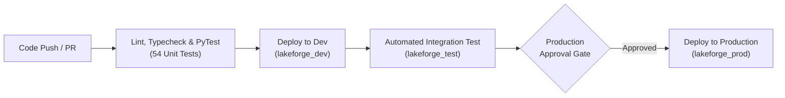

<div align="center">

# ⚡ LakeForge

### *The Enterprise Metadata-Driven Medallion Data Lakehouse Framework*

[](https://jayarampogakula.github.io/lakeforge-docs/)
[](https://docs.databricks.com/)
[](https://delta.io/)
[](https://www.python.org/)
[](LICENSE)
[](deployment/)
[](tests/)

<p align="center">
  <a href="https://jayarampogakula.github.io/lakeforge-docs/"><strong>🌐 Live Interactive Documentation Portal</strong></a> •
  <a href="#-key-features"><strong>Key Features</strong></a> •
  <a href="#-medallion-architecture"><strong>Architecture</strong></a> •
  <a href="#-quickstart"><strong>Quickstart</strong></a> •
  <a href="#-data-source-connectors"><strong>Connectors</strong></a> •
  <a href="#-governance--security"><strong>Governance</strong></a> •
  <a href="#-cicd--multi-stage-deployment"><strong>CI/CD</strong></a>
</p>

---

</div>

## 📌 Executive Summary

**LakeForge** is a production-grade, metadata-driven Data Lakehouse framework engineered for **Databricks**, **Delta Lake**, and **Apache Spark**. It empowers enterprise data teams to build, test, secure, and operate end-to-end Medallion pipelines (**Bronze ➔ Silver ➔ Gold**) completely driven by declarative JSON configuration.

By decoupling data engineering logic from business rules, LakeForge eliminates thousands of lines of bespoke glue code while embedding automated **schema drift detection**, **quarantine isolation**, **Unity Catalog fine-grained PII masking**, **table optimization suites**, and **multi-tenant client scoping**.

---

## 🏛 Medallion Architecture

LakeForge enforces strict, automated data contracts and quality gates across every layer of the lakehouse:

```mermaid
flowchart LR
    subgraph Sources["📥 Multi-Source Ingestion"]
        S1["RDBMS (Oracle, Postgres, MySQL)"]
        S2["Cloud DWH (Snowflake, BigQuery, Redshift)"]
        S3["Cloud Storage (S3, ADLS Gen2, GCS)"]
        S4["Streaming & SaaS (Kafka, Jira, SharePoint)"]
    end

    subgraph Bronze["🥉 Bronze Layer (Raw & Audited)"]
        B1["Universal Ingestion Engine"]
        B2["Schema Drift Guardrails\n(Strict / Allow / Quarantine)"]
        B3["Metadata Audit Ledger\n(_ingestion_timestamp, _batch_id)"]
    end

    subgraph Quality["🛡 Quality Gate & Quarantine"]
        Q1["Data Quality Rules Engine\n(Null, Range, Regex, Allowed, Dedupe)"]
        Q2{"Quality Passed?"}
        Q3["Quarantine Table\n(_quarantine_reason, failed_record)"]
    end

    subgraph Silver["🥈 Silver Layer (Cleansed & Enriched)"]
        SV1["Schema Enforcement & Normalization"]
        SV2["SCD Type 1 & Type 2 Upserts"]
        SV3["Deterministic Deduplication & Type Casting"]
    end

    subgraph Gold["🥇 Gold Layer (Curated & Governed)"]
        G1["Star & Snowflake Mart Aggregations"]
        G2["Delta Materialized & Temp Views"]
        G3["Unity Catalog Governance\n(PII Column Masking & Row Filters)"]
        G4["Automated Table Maintenance\n(OPTIMIZE + Z-ORDER + VACUUM)"]
    end

    subgraph Consumers["🚀 Consumption & Analytics"]
        C1["BI & Analytics (Power BI / Tableau)"]
        C2["AI & Machine Learning (MLflow / Feature Store)"]
        C3["Real-time Executive Reporting"]
    end

    Sources --> Bronze
    Bronze --> Quality
    Q2 -- "❌ Failed" --> Q3
    Q2 -- "✅ Passed" --> Silver
    Silver --> Gold
    Gold --> Consumers
```



---

## ✨ Key Features

| Capability | Enterprise Value | LakeForge Implementation |
| :--- | :--- | :--- |
| **Declarative JSON Engine** | Zero repetitive code; configure tables, schemas, and queries in JSON | `lakeforge.metadata.ConfigParser` |
| **Universal Connectors** | 15+ pre-built high-performance connectors for Batch, Stream & SaaS | `lakeforge.ingestion.*` |
| **Schema Drift & Quarantine** | Enforces strict schema contracts; segregates drifted records safely | `lakeforge.bronze.BronzeWriter` |
| **Data Quality Gate** | Multi-rule DQ verification with configurable threshold tolerances | `lakeforge.dq.DQEngine` |
| **SCD Type 1 & 2 Engine** | Automates historical delta changes, valid-from/to flags, and active records | `lakeforge.silver.SilverTransformer` |
| **Gold Marts & Views** | Windowed metrics, multidimensional rollups, and persistent Delta views | `lakeforge.gold.GoldAggregator` |
| **Unity Catalog Governance** | Automated DDL grants, dynamic column PII masking & row-level filters | `lakeforge.governance.GovernanceEngine` |
| **Automated Maintenance** | Scheduled compaction, Z-Ordering, file cleanup, and optimizer stats | `lakeforge.maintenance.TableMaintenanceSuite` |
| **Multi-Tenant Scoping** | Hierarchical configuration overrides per client or subsidiary tenant | `configs/clients/<client_id>/` |
| **Enterprise Observability** | Centralized run ledger, execution metrics, and multi-channel alerts | `lakeforge.observability.*` |
| **Dual CI/CD Orchestration** | Native pipelines for both Azure DevOps and GitHub Actions + Terraform | `azure-pipelines.yml` & `.github/workflows/` |

---

## 🔌 Data Source Connectors

LakeForge provides native, optimized connectors with pushdown predicates and secret masking:

<div align="center">

| Category | Supported Platforms | Ingestion Modes |
| :--- | :--- | :--- |
| **Cloud Data Warehouses** | **Snowflake**, **Google BigQuery**, **AWS Redshift** | Full Snapshot, Incremental Query, JDBC Pushdown |
| **Relational Databases** | **Oracle**, **PostgreSQL**, **MySQL / MariaDB**, **Azure SQL** | Partitioned JDBC, Watermark Incremental, Parallel Slices |
| **NoSQL & Document** | **MongoDB**, **Azure Cosmos DB** | JSON Projection, Aggregation Pipeline Extraction |
| **Cloud Object Storage** | **Azure ADLS Gen2**, **AWS S3**, **Google Cloud Storage (GCS)** | Databricks Auto Loader, Parquet, Delta, CSV, JSON, Avro |
| **Streaming & Events** | **Apache Kafka**, **Azure Event Hubs** | Structured Streaming, Watermark Windows, Checkpointing |
| **Enterprise SaaS** | **Jira Cloud / Server**, **SharePoint Online**, **Google Sheets** | REST API pagination, OAuth2 / Token, Excel/CSV Parser |

</div>

---

## ⚡ Quickstart

### 1. Installation

Install LakeForge locally or directly onto your Databricks cluster:

```bash
# Clone the official repository
git clone https://github.com/jayarampogakula/lakeforge.git
cd lakeforge

# Install core framework in editable mode
pip install -e .

# Or install with all enterprise database & cloud drivers
pip install -e ".[all]"
```

### 2. LakeForge CLI

LakeForge includes an enterprise CLI tool for validating configurations and orchestrating runs:

```bash
# Initialize a new metadata configuration project structure
lakeforge init --target ./my_lakehouse

# Validate all JSON configurations across environments
lakeforge validate --config-dir ./configs

# Run local or remote pipeline validation
lakeforge run --pipeline customers --source-system erp --stage dev
```

---

## 📓 Databricks Production Notebooks

LakeForge ships with 6 modular, parameter-driven Databricks notebooks in the `pipelines/` folder:

```
pipelines/
├── Bronze_Generic_Pipeline.ipynb       # Universal multi-source ingestion & schema drift
├── SILVER_Transformation_Pipeline.ipynb # Cleansing, deduplication, type casting & SCD-2
├── GOLD_Aggregation_Pipeline.ipynb     # Dimension/Fact aggregations & KPI rollups
├── VIEWS_Creation_Pipeline.ipynb        # Secure temporary & persistent Delta views
├── GOVERNANCE_Security_Pipeline.ipynb   # Unity Catalog grants, column PII masks & row filters
└── MAINTENANCE_Table_Optimization.ipynb # OPTIMIZE, Z-ORDER, VACUUM & ANALYZE statistics
```

> **Dynamic Path Resolution**: Every notebook automatically resolves `config_dir` relative to its execution workspace. No hardcoded personal directories are ever required.

---

## 🛡 Governance, PII Masking & Row Filters

LakeForge integrates natively with **Databricks Unity Catalog** to automate zero-trust data access:

```json
{
  "catalog": "lakeforge_{stage}",
  "schema": "gold",
  "table": "dim_customers",
  "pii_masking": [
    {
      "column": "email",
      "mask_type": "email_mask",
      "authorized_principal": "lakeforge_data_officers"
    },
    {
      "column": "ssn_tax_id",
      "mask_type": "sha256",
      "authorized_principal": "lakeforge_compliance"
    }
  ],
  "row_filters": [
    {
      "filter_name": "region_security_filter",
      "filter_column": "region",
      "allowed_group": "emea_analysts",
      "allowed_values": ["EMEA", "GLOBAL"]
    }
  ]
}
```

---

## 🏢 Multi-Tenant Client Architecture

LakeForge supports enterprise multi-tenancy out-of-the-box. Pipeline configurations can be globally defined and selectively overridden per tenant:

```
configs/
├── ingestion/                  # Global default ingestion configurations
│   └── customers.json
├── dq/                         # Global quality verification rules
│   └── customers_rules.json
└── clients/                    # Client-specific override hierarchy
    ├── client_alpha/
    │   ├── ingestion/customers.json    # Tenant-specific source endpoints
    │   └── dq/customers_rules.json     # Custom strict tolerance thresholds
    └── client_beta/
        └── transformations/orders.json # Specialized regional tax logic
```

When passing `client_id="client_alpha"` into any pipeline or notebook, LakeForge automatically merges configurations with tenant overrides taking precedence.

---

## 🚀 CI/CD & Multi-Stage Deployment

LakeForge is built for enterprise DevOps across multi-cloud environments. Every commit runs automated quality checks and stage-aware deployments:



### Supported CI/CD Orchestrators

- **Azure DevOps**: Pre-configured multi-stage pipeline defined in [`azure-pipelines.yml`](azure-pipelines.yml) with approval gates and secret linking.
- **GitHub Actions**: Automated CI/CD workflow defined in [`.github/workflows/ci_cd.yml`](.github/workflows/ci_cd.yml).
- **Databricks Asset Bundles (DAB)**: Declared in [`databricks.yml`](databricks.yml) for serverless workflow execution.
- **Terraform Infrastructure as Code**: Full cluster, secret scope, and workflow provisioning in [`deployment/terraform/`](deployment/terraform/).

---

## 📂 Repository Directory Structure

```
lakeforge/
├── .github/workflows/         # GitHub Actions multi-stage CI/CD
├── configs/                    # Declarative JSON configs (Metadata Engine)
│   ├── aggregations/          # Gold layer aggregation definitions
│   ├── clients/               # Multi-tenant client overrides
│   ├── dq/                    # Data quality rule suites & tolerances
│   ├── environments/          # Stage configs (dev, test, staging, prod)
│   ├── governance/            # Unity Catalog grants, PII masks & row filters
│   ├── ingestion/             # Source connectors & schema drift policies
│   ├── pipelines/             # End-to-end pipeline graphs
│   ├── transformations/       # Silver cleaning & business transformations
│   └── views/                 # View generation queries
├── deployment/                 # Enterprise deployment manifests
│   ├── airflow/               # Apache Airflow DAG definitions
│   ├── docker/                # Isolated container runtimes
│   ├── terraform/             # Terraform Databricks Workspace & Job IaC
│   └── workflows/             # Databricks Workflow job definitions
├── lakeforge/                  # Core Python Package
│   ├── bronze/                # Raw ingestion, audit stamps, schema evolution
│   ├── cli/                   # lakeforge CLI tool
│   ├── dq/                    # Data quality engine & quarantine router
│   ├── gold/                  # Aggregators & business marts
│   ├── governance/            # Unity Catalog security & masking DDL
│   ├── ingestion/             # 15+ Data source loaders
│   ├── maintenance/           # OPTIMIZE, VACUUM, ANALYZE suite
│   ├── metadata/              # Config parser & multi-tenant resolver
│   ├── observability/         # Audit ledger, metrics & alert dispatcher
│   ├── silver/                # Cleanse, cast, dedup & SCD-2 transformer
│   └── views/                 # Temp & persistent view manager
├── pipelines/                  # 6 Reusable Databricks Medallion Notebooks
├── tests/                      # Unit & integration test suites (54 tests)
├── azure-pipelines.yml         # Azure DevOps multi-stage CI/CD pipeline
├── databricks.yml              # Databricks Asset Bundle (DAB) manifest
├── pyproject.toml              # Modern Python packaging & dependencies
└── requirements.txt            # Python dependencies
```

---

## 🌐 Official Documentation Portal

For the complete interactive experience, comprehensive class and function references, configuration schema dictionaries, and step-by-step guides, visit our documentation portal:

👉 **[LakeForge Official Interactive Documentation](https://jayarampogakula.github.io/lakeforge-docs/)**

👉 **[Documentation Repository (lakeforge-docs)](https://github.com/jayarampogakula/lakeforge-docs)**

All source connector guides, data quality manuals, architecture specifications, tutorials, and API references are actively maintained at [**jayarampogakula/lakeforge-docs**](https://github.com/jayarampogakula/lakeforge-docs).

---

## 📄 License

LakeForge is open-source software licensed under the [Apache License 2.0](LICENSE).

---

<div align="center">
  <sub>Engineered with precision for the modern enterprise Data Lakehouse community.</sub>
</div>
