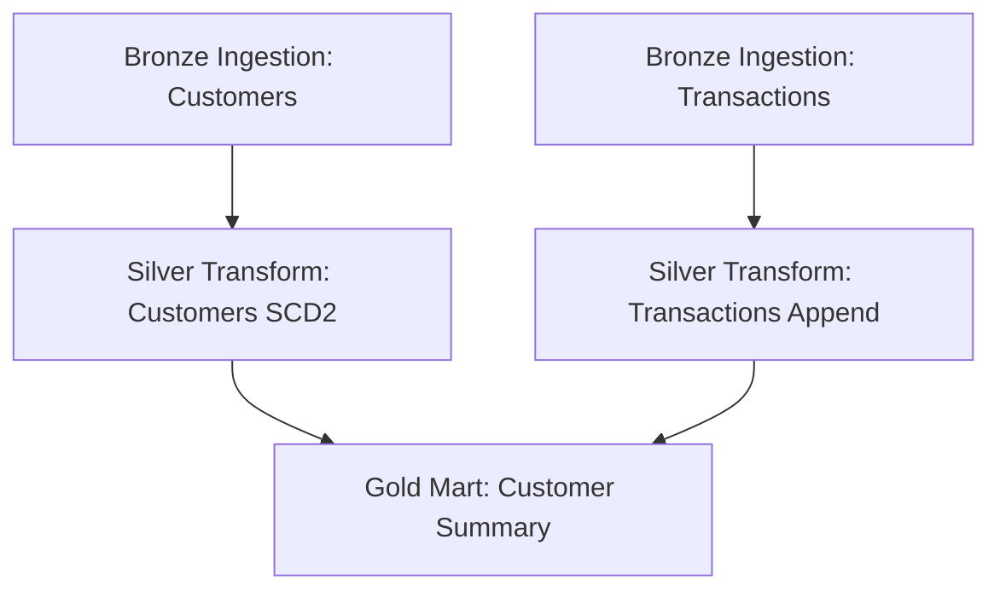

# LakeForge Orchestration Guide

This folder contains guidelines for orchestrating LakeForge pipelines on enterprise schedulers: Databricks Workflows, Apache Airflow, and Azure Data Factory.

---

## 0. Branching & Environment Policy (enforced in CI/CD)

All development happens in **dev** (any branch: main, dev, feature/**, bugfix/**). Every other environment builds from **main only** - no feature-branch runs outside dev.

| Environment | Allowed source | Trigger |
| --- | --- | --- |
| dev | ANY branch (main, dev, feature/**, bugfix/**) | CI on every push |
| test | main only | automatic on push to main (dev -> test promotion) |
| staging | main only | manual dispatch, run from main |
| prod | main only | manual dispatch, run from main |

How it is enforced in this repo:

1. `.github/workflows/ci_cd.yml` - push to `main` builds and deploys **test**; pushes to `dev`/`feature/**`/`bugfix/**` deploy to **dev** only. A hard guard step (`Enforce Branch Policy`) fails the run with an error if any stage other than dev is requested while not on `main`.
2. `azure-pipelines.yml` - the same guard (`Enforce Branch Policy` step) in the DeployStage: stage != dev and branch != main -> run fails.
3. `databricks.yml` - the `test`, `staging`, and `prod` bundle targets use `mode: production` (locked bundle state, no uncommitted changes, no destructive permission changes); `dev` uses a plain target (no mode) with a user-scoped `root_path` so job names stay clean and personal deployments stay isolated.

**Immutability of deployed branches** - do once at the Git host:

- GitHub: Settings -> Branches -> add a branch protection rule for `main`: require pull request + reviews, block direct pushes, restrict deletions. Changes reach `main` only through reviewed PRs.
- Azure DevOps: Repos -> Branch Policies on `main`: require a minimum number of reviewers and linked work items, prohibit self-approval.

With protection on, a bundled deployment from `main` is fully reproducible: the exact committed code is what runs in test/staging/prod - no direct edits to deployed branches are possible.

---

## 0.5 Multi-Bundle Deployment Layout (per-client bundles)

Databricks' recommended multi-bundle pattern: one repo, one bundle per deployment unit. Each client is an INDEPENDENT bundle - deploying or running one client never touches another.

```
lakeforge/
├── databricks.yml                              # MAIN bundle (global medallion job)
├── deployments/                                # PER-CLIENT bundles (one independent bundle per client)
│   └── client_alpha/
│       ├── databricks.yml                   # CLIENT bundle (independent)
│       └── resources/
│           ├── client_alpha_etl_job.yml    # provisioning(client_alpha) -> bronze sales -> silver sales_clean -> views -> governance
│           └── client_alpha_views_job.json # on-demand views refresh (JSON resources work alongside yml)
└── infrastructure/
    └── databricks/resources/
        └── lakeforge_global_job.yml            # provisioning(env) -> bronze -> silver -> gold -> views -> governance
```

**Adding a client** = copy `deployments/client_alpha/` to `deployments/<new_client>/`, change the `client_id` / names, add its configs under `configs/<type>/<new_client>/`. No changes to the main bundle.

**Deploy only a selected client** (the per-client question):

- Global: `databricks bundle deploy -t dev` (from repo root)
- Only client_alpha: `cd deployments/client_alpha && databricks bundle deploy -t dev`
- Run only client_alpha's ETL job: `databricks bundle run client_alpha_etl_pipeline -t dev`
- Via the LakeForge CLI: `lakeforge deploy --stage dev --client client_alpha` (the CI client_id parameter maps to this)

Notes (verified with `databricks bundle validate`):

- Client bundles sync the shared framework (`pipelines/`, `configs/`, `lakeforge/`) from the repo root via `sync.paths` - no code duplication.
- Relative paths in resource files (`notebook_path`) are resolved relative to the RESOURCE FILE's location: `../../../pipelines/...` reaches the repo root from BOTH `infrastructure/databricks/resources/` and `deployments/<client>/resources/` (three levels up in each); client bundle `sync.paths` use `../../` (two levels up from the client bundle root).
- The dev target `root_path` is user-scoped (`~/.lakeforge/...`) as required by DAB development mode; test/staging/prod use `/Workspace/Shared/...` (validate warns it is writable by all users - restrict it or add CAN_MANAGE for `users` if that is intentional).

---

## 1. Databricks Workflows

Databricks Workflows is the recommended scheduler for LakeForge pipelines due to direct integration with Unity Catalog, Job clusters, and notebook task logging.

### Ideal Multitask Job Structure
Our Terraform script deploys a job with the following dependency structure:



Each notebook is run on a shared **Job Cluster** to isolate compute costs.

---

## 2. Apache Airflow Integration

If you prefer external orchestration, you can trigger notebooks using the `DatabricksSubmitRunOperator` or `DatabricksRunNowOperator`.

### Example Airflow DAG
```python
from airflow import DAG
from airflow.providers.databricks.operators.databricks import DatabricksRunNowOperator
from datetime import datetime

with DAG(
    dag_id="lakeforge_etl_pipeline",
    start_date=datetime(2026, 1, 1),
    schedule_interval="@daily",
    catchup=False
) as dag:

    # Trigger Bronze Ingestion
    ingest_cust = DatabricksRunNowOperator(
        task_id="ingest_customers",
        job_id="123456",  # Databricks Job ID
        notebook_params={
            "config_dir": "",  # Blank auto-resolves relative to repo
            "pipeline_name": "customers",
            "environment": "prod"
        }
    )

    ingest_txns = DatabricksRunNowOperator(
        task_id="ingest_transactions",
        job_id="123456",
        notebook_params={
            "config_dir": "",  # Blank auto-resolves relative to repo
            "pipeline_name": "transactions",
            "environment": "prod"
        }
    )

    # Trigger Silver Clean
    clean_cust = DatabricksRunNowOperator(
        task_id="clean_customers",
        job_id="789012",
        notebook_params={
            "config_dir": "",  # Blank auto-resolves relative to repo
            "source_table": "customers",
            "target_table": "customers_clean",
            "use_scd_type2": "true",
            "environment": "prod"
        }
    )

    clean_txns = DatabricksRunNowOperator(
        task_id="clean_transactions",
        job_id="789012",
        notebook_params={
            "config_dir": "",  # Blank auto-resolves relative to repo
            "source_table": "transactions",
            "target_table": "transactions_clean",
            "use_scd_type2": "false",
            "environment": "prod"
        }
    )

    # Trigger Gold Aggregations
    gold_summary = DatabricksRunNowOperator(
        task_id="gold_summary",
        job_id="345678",
        notebook_params={
            "config_dir": "",  # Blank auto-resolves relative to repo
            "business_domain": "sales",
            "target_table": "customer_summary",
            "environment": "prod"
        }
    )

    ingest_cust >> clean_cust >> gold_summary
    ingest_txns >> clean_txns >> gold_summary
```
